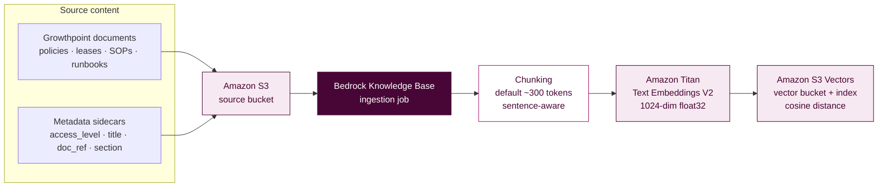
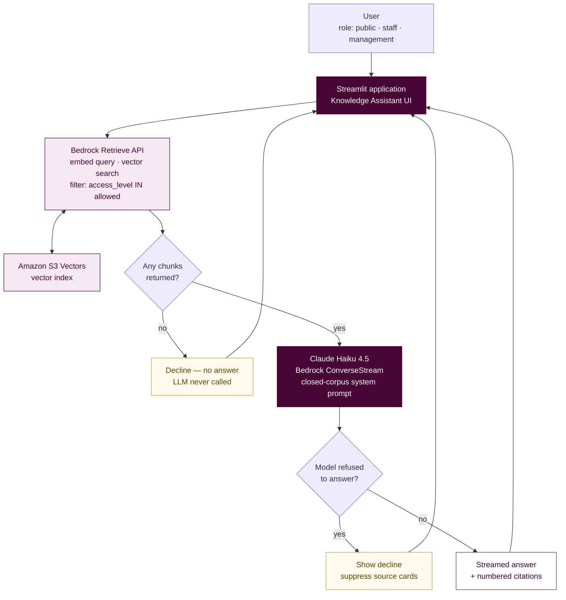
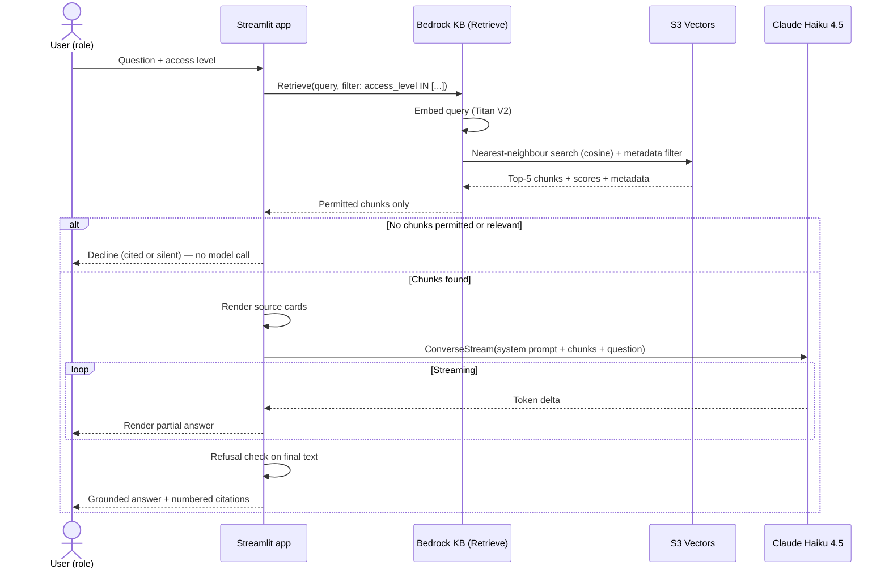
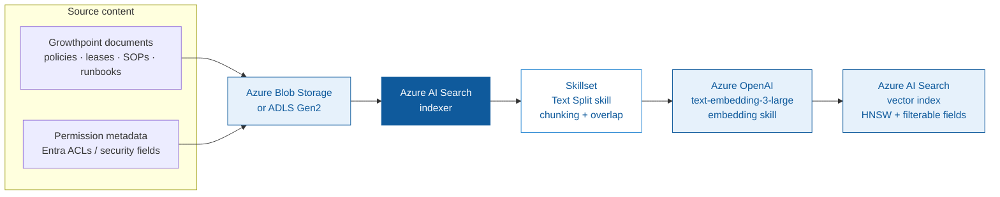
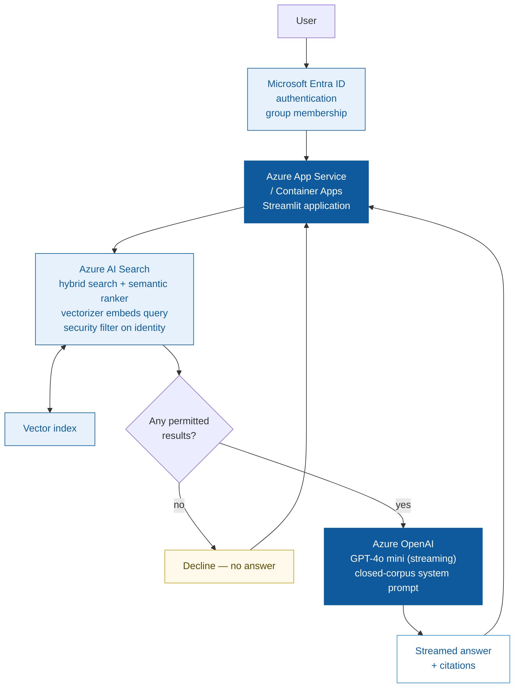
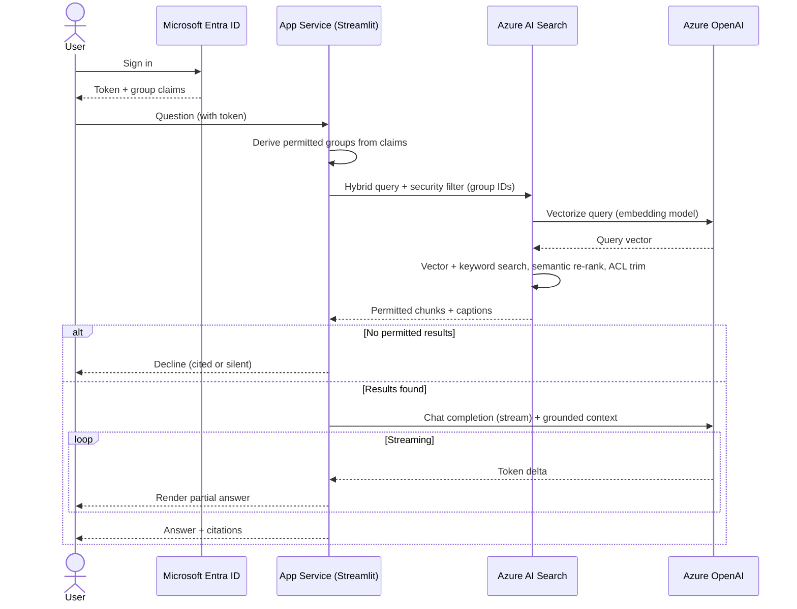

# Growthpoint Knowledge Assistant — Solution Overview

**A Retrieval-Augmented Generation (RAG) proof of concept**
Built on AWS Bedrock Knowledge Bases with Amazon S3 Vectors · with an equivalent Azure design

| | |
|---|---|
| **Document purpose** | Explain the demo, the RAG concepts behind it, the AWS implementation in detail, and how the same solution would be built on Azure |
| **Status** | Proof of concept with mock data. Real Growthpoint documents to be ingested later |
| **Audience** | Growthpoint technical and business stakeholders |

---

## Table of contents

1. [What the demo does](#1-what-the-demo-does)
2. [RAG concepts explained](#2-rag-concepts-explained)
3. [Chunking in depth](#3-chunking-in-depth)
4. [Embeddings in depth](#4-embeddings-in-depth)
5. [The retrieval and generation process](#5-the-retrieval-and-generation-process)
6. [How AWS implements this](#6-how-aws-implements-this)
7. [AWS architecture](#7-aws-architecture)
8. [Enforcing the guardrails](#8-enforcing-the-guardrails)
9. [The same solution on Azure](#9-the-same-solution-on-azure)
10. [Azure architecture](#10-azure-architecture)
11. [AWS to Azure service mapping](#11-aws-to-azure-service-mapping)
12. [Operational considerations](#12-operational-considerations)
13. [Sources](#13-sources)

---

## 1. What the demo does

The Growthpoint Knowledge Assistant is a chat interface that answers questions
about Growthpoint's own documents — leases, policies, standard operating
procedures (SOPs) and technical runbooks. It does not answer from the open
internet and it does not rely on what the language model happens to remember
from its training data.

### The four capabilities

| Capability | What it means in practice |
|---|---|
| **Answers from your content** | Policies, lease and property documents, SOPs and technical runbooks are *retrieved* from a document store and used to compose the answer, rather than guessed at |
| **Shows its working** | Every answer displays the documents it drew from — document title, reference number, section and an extract — so a reader can verify the claim |
| **Respects who is asking** | Permission-aware retrieval. A user only ever retrieves documents their role is entitled to see |
| **Improves with use** | Thumbs up / down feedback on each answer surfaces knowledge gaps and poor answers, so the knowledge base can be improved over time |

### The three guardrails

| Guardrail | Implementation |
|---|---|
| **Closed corpus** | Only the ingested documents are searched. There is no open-web fallback and no tool that can reach the internet |
| **No public training** | Content stays inside the AWS account boundary. Amazon Bedrock does not use customer inputs or outputs to train its foundation models |
| **Cited or silent** | If retrieval returns nothing relevant, the assistant declines to answer rather than inventing one. No source means no answer |

### Demonstration data

The PoC ships with **25 fictional Growthpoint documents** written for
demonstration purposes, spread across four categories and three access levels:

| Category | Count | Examples |
|---|---|---|
| Policy | 9 | Tenant Parking & Access, Sustainability & Green Building, Arrears & Credit Control |
| Lease Document | 5 | Standard Office Lease — Operating Costs, Lease Renewal & Early Termination |
| SOP | 6 | Tenant Maintenance Request, Emergency Evacuation, New Tenant Onboarding |
| Technical Runbook | 5 | HVAC/BMS Fault Response, Loadshedding & Generator, Solar PV & Backup Power |

| Access level | Count | Who sees it |
|---|---|---|
| `public` | 9 | Tenants and the general public |
| `staff` | 13 | Growthpoint staff (plus everything public) |
| `management` | 3 | Management (plus everything staff and public) |

### Demonstrating the guardrails

The demo is designed so each guardrail can be proven in a live session:

| Ask this | As this role | Expected behaviour |
|---|---|---|
| "How is tenant parking allocated?" | Tenant / Public | Answers, citing the Tenant Parking & Access Policy |
| "How are operating costs calculated in an office lease?" | Tenant / Public | **Declines** — the lease document is staff-level |
| Same question | Growthpoint Staff | Answers, citing the Standard Office Lease |
| "What is the arrears collection process?" | Growthpoint Staff | **Declines** — the arrears policy is management-only |
| Same question | Management | Answers, citing the Arrears & Credit Control Policy |
| "What is the capital of France?" | Any | **Declines** — outside the closed corpus |

---

## 2. RAG concepts explained

### The problem RAG solves

A large language model (LLM) such as Claude is trained on a large, general body
of text up to a fixed cut-off date. That creates three problems for enterprise
use:

1. **It has never seen your private documents.** Growthpoint's lease clauses and
   internal runbooks were not in the training data, so the model cannot know them.
2. **It cannot cite a source.** The model's knowledge is distributed across its
   weights, not stored as retrievable documents, so it cannot tell you where an
   answer came from.
3. **It will answer anyway.** Asked a question outside its knowledge, a model
   will often produce a fluent, confident and wrong answer — a hallucination.
   For a lease clause or a safety procedure, that is unacceptable.

The naive fix is to fine-tune the model on your documents. That is expensive,
slow to update, still cannot cite sources, and bakes the content into model
weights. Retrieval-Augmented Generation takes a different approach.

### The core idea

> Instead of asking the model what it knows, find the relevant passages first,
> then ask the model to answer *using only those passages*.

RAG splits the problem into **retrieval** (a search problem) and **generation**
(a language problem). The model is reduced from an oracle to a careful reader and
summariser of text you supply. Because the passages are real documents you
control, the answer can be cited, the corpus can be closed, and the content can
be permission-filtered before the model ever sees it.

### The two phases

Every RAG system has an offline phase that prepares the data and an online phase
that answers a question.

**Phase 1 — Ingestion (offline, runs when documents change)**

```
Documents  ──▶  Parse  ──▶  Chunk  ──▶  Embed  ──▶  Store vectors + metadata
```

1. **Parse** — extract plain text from the source files (PDF, DOCX, HTML, TXT).
2. **Chunk** — split the text into passages small enough to embed meaningfully.
3. **Embed** — convert each chunk into a numeric vector using an embedding model.
4. **Store** — write the vectors, the original text and the metadata to a vector index.

**Phase 2 — Retrieval and generation (online, runs per question)**

```
Question ──▶ Embed ──▶ Vector search (+ filters) ──▶ Top-K chunks
                                                         │
                                          ┌──────────────┘
                                          ▼
                    Prompt = instructions + chunks + question ──▶ LLM ──▶ Answer + citations
```

1. **Embed the question** with the *same* embedding model used at ingestion.
2. **Search** the vector index for the chunks whose vectors are nearest the
   question vector, applying any access filters.
3. **Assemble a prompt** containing the retrieved chunks as context, the user's
   question, and instructions constraining the model to that context.
4. **Generate** the answer and return it with the citations.

### Why vectors

Keyword search matches characters. If a tenant asks "how many parking bays do I
get?" and the policy says "allocated at a ratio of 1 bay per 25 square metres of
leased GLA", a keyword search for "how many" finds nothing useful.

An **embedding** maps text to a point in high-dimensional space such that texts
with similar *meaning* land close together, regardless of the words used. The
question and the policy clause end up near each other because they are about the
same concept. This is **semantic search**, and it is what makes RAG work on
natural-language questions.

---

## 3. Chunking in depth

### Why chunk at all

Three independent constraints force documents to be split:

| Constraint | Explanation |
|---|---|
| **Embedding model input limit** | Titan Text Embeddings V2 accepts up to 8,192 tokens (about 50,000 characters) per call. Longer documents simply cannot be embedded in one piece ([AWS docs](https://docs.aws.amazon.com/bedrock/latest/userguide/titan-embedding-models.html)) |
| **Retrieval precision** | One vector per 50-page document averages away all the detail. A query about parking would match a facilities manual weakly and unhelpfully. Smaller chunks produce sharper matches |
| **Prompt economy** | The retrieved text is pasted into the prompt and billed as input tokens. Returning whole documents is slow and expensive; returning the relevant clause is neither |

The trade-off runs in both directions. Chunks that are too **small** lose the
context needed to make sense (a clause that says "this does not apply to
B-grade buildings" is meaningless alone). Chunks that are too **large** dilute
the embedding and waste prompt budget. The goal is one coherent idea per chunk.

### The strategies Amazon Bedrock supports

Amazon Bedrock Knowledge Bases offers several built-in approaches. Content is
split into chunks, converted to embeddings and written to the vector index while
preserving a mapping back to the source document
([AWS docs](https://docs.aws.amazon.com/bedrock/latest/userguide/kb-chunking.html)).

| Strategy | How it works | Best suited to |
|---|---|---|
| **Default** | Splits text into chunks of roughly 300 tokens, respecting sentence boundaries so sentences are never cut in half | General-purpose text; a sound starting point |
| **Fixed-size** | You specify the token count per chunk and an overlap percentage between consecutive chunks | Tuning when you know your document structure; overlap preserves context across boundaries |
| **Semantic** | Uses embeddings to detect topic shifts between sentences and breaks where meaning changes. Tunable via maximum tokens, a buffer of surrounding sentences, and a breakpoint percentile threshold | Flowing prose where topics change at unpredictable points. Note: incurs extra cost because it uses a foundation model |
| **Hierarchical** | Builds nested parent and child chunks. Retrieval matches on the small, precise child chunks but substitutes the larger parent chunk to give the model fuller context | Long structured documents where precision and context are both needed |
| **No chunking** | Each document is treated as a single chunk. Expects you to have pre-split the files yourself | Content already split into small, self-contained files |

An important caveat for our design: AWS advises that **hierarchical chunking is
not recommended when using an S3 vector bucket**, because parent-child
relationships are held as metadata and large combined token counts can exceed S3
Vectors' metadata size limits.

### What this demo uses, and why

The implementation does **not** set a chunking configuration, so the knowledge
base applies **default chunking** — approximately 300 tokens per chunk,
honouring sentence boundaries.

This is deliberate and appropriate here, for a specific reason: each mock
document is a single focused clause or procedure of roughly 90 to 130 words.
Most therefore fit comfortably inside one 300-token chunk. The effect is that
**one document equals one chunk**, which is ideal for this PoC because:

- Each retrieved chunk is a complete, self-contained policy clause or procedure.
- Citations map cleanly to one source document, with nothing truncated mid-thought.
- Access-level metadata applies unambiguously to the whole chunk.

When real Growthpoint documents arrive, this will need revisiting. A 40-page
lease agreement or a full technical manual will span many chunks, and the
default strategy may split a clause across a boundary. The recommendation at
that point is to evaluate **fixed-size chunking with overlap** (so a clause
broken across a boundary still appears whole in one of the two chunks), or
**semantic chunking** for flowing prose. The chunking strategy **cannot be
changed after a data source is created**, so it must be chosen before the real
ingestion — changing it means recreating the data source and re-ingesting.

---

## 4. Embeddings in depth

### What an embedding is

An embedding model converts a piece of text into a fixed-length list of numbers
— a **vector**. The model is trained so that semantically similar texts produce
vectors that point in similar directions. A 1,024-dimension vector is a point in
1,024-dimensional space; "proximity" in that space approximates similarity of
meaning.

A simplified illustration of the principle:

```
"parking bays per square metre"   ──▶  [ 0.021, -0.118,  0.043, ...,  0.009 ]   (1,024 numbers)
"how many parking spots do I get" ──▶  [ 0.019, -0.121,  0.038, ...,  0.011 ]   ← very close
"fire evacuation assembly point"  ──▶  [-0.084,  0.203, -0.157, ..., -0.066 ]   ← far away
```

### The model used here

This solution uses **Amazon Titan Text Embeddings V2**
(`amazon.titan-embed-text-v2:0`).

| Property | Value | Notes |
|---|---|---|
| Maximum input | 8,192 tokens / ~50,000 characters | Per AWS documentation |
| Output dimensions | **1,024** (configured) | V2 also supports 512 and 256 |
| Data type | `float32` | S3 Vectors supports floating-point vectors; binary vectors are not supported |
| Distance metric | **Cosine** (configured) | Measures angle between vectors, ignoring magnitude |
| Languages | 100+ | |

Titan V2's configurable output size is a genuine cost/accuracy dial. AWS reports
that reducing from 1,024 to 512 dimensions retains roughly **99%** of retrieval
accuracy, and reducing to 256 dimensions retains about **97%**
([AWS announcement](https://aws.amazon.com/about-aws/whats-new/2024/06/amazon-titan-text-embeddings-v2-bedrock-knowledge-bases/)).
Smaller vectors mean less storage and faster queries.

**Why 1,024 was chosen here:** the corpus is tiny, so storage and query cost are
negligible, and maximum retrieval accuracy is worth more than a marginal saving.
At Growthpoint's real scale — potentially hundreds of thousands of chunks — 512
dimensions would be worth benchmarking, since it roughly halves vector storage
for about 1% accuracy loss.

**Why Titan rather than a third-party model:** Amazon's first-party embedding
models are the most cost-effective option on Bedrock, and Titan V2 is explicitly
optimised for retrieval tasks.

### The critical rule

> The same embedding model must be used for ingestion and for queries.

Vectors from different models are not comparable — they describe different
spaces. Changing the embedding model, or its dimension count, requires
**re-embedding the entire corpus**. This is why the embedding model is the most
consequential and least reversible choice in a RAG system.

### Cosine similarity

Cosine similarity measures the angle between two vectors rather than the
distance between their endpoints, which makes it insensitive to document length:

- **1.0** — identical direction (same meaning)
- **0.0** — orthogonal (unrelated)
- **−1.0** — opposite direction

A long document and a short query about the same topic point the same way even
though their magnitudes differ greatly. This is why cosine is the conventional
choice for text retrieval.

---

## 5. The retrieval and generation process

This section traces one question end to end, as the implementation actually
performs it.

### Step 1 — The user asks a question

A tenant, signed in at the `public` access level, asks:

> "How is tenant parking allocated?"

### Step 2 — Retrieval with a permission filter

The application calls the Bedrock `Retrieve` API. Behind that single call,
Bedrock embeds the question with Titan V2 and runs a nearest-neighbour search
against the S3 Vectors index.

Critically, a **metadata filter** is applied as part of the search:

```python
# public      -> ["public"]
# staff       -> ["public", "staff"]
# management  -> ["public", "staff", "management"]
{"in": {"key": "access_level", "value": allowed_levels}}
```

A user at a given level may retrieve documents at their level and below. The
filter is applied **inside the search**, not after it, so restricted chunks are
never returned to the application, never placed in a prompt, and never sent to
the model. This is the mechanism behind "respect who is asking", and the
ordering matters: filtering at the datastore is an access control, whereas
filtering after retrieval would merely be a display preference.

The call requests the top **5** results and returns, for each: the chunk text,
a relevance score, and the metadata (title, category, document reference,
section, access level).

### Step 3 — The cited-or-silent decision

Retrieval happens **before** generation, deliberately. If the filtered search
returns no results, the application returns a decline immediately and **never
calls the language model at all**. This makes "no source, no answer" a
structural property of the system rather than a request to the model, and it
avoids paying for a generation call that should not happen.

### Step 4 — Grounded generation, streamed

When chunks are found, they are assembled into a prompt alongside a system
instruction that constrains the model:

> Answer the question using ONLY the information in the provided context. Do not
> use any outside knowledge and do not guess. If the context does not contain
> the answer, reply that you cannot find it in the Growthpoint knowledge base...

The prompt is sent to **Claude Haiku 4.5** via the Bedrock **ConverseStream**
API, which returns the answer incrementally as it is generated. The interface
renders each fragment as it arrives, so the user sees the answer forming rather
than waiting at a blank screen. Generation parameters are set for factual
consistency rather than creativity:

| Parameter | Value | Reason |
|---|---|---|
| `temperature` | 0.1 | Near-deterministic. High temperature invites embellishment, which is the opposite of what a citation-bound assistant needs |
| `maxTokens` | 1000 | Sufficient for a thorough procedural answer |
| `numberOfResults` | 5 | Enough context to answer without flooding the prompt |

### Step 5 — Refusal detection

Vector search always returns its nearest neighbours, even when nothing is truly
relevant — ask about the capital of France and it will still return the five
least-unrelated property documents. In that situation the model, following its
instructions, correctly replies that it cannot find the answer.

The application detects these refusals and treats them as silence: the answer is
flagged as unanswered and **the source cards are suppressed**. Without this, the
interface would display a refusal alongside three confident-looking citations,
implying the documents supported an answer they did not. This is a small detail
with a real integrity benefit.

### Step 6 — Presenting the citations

A successful answer is displayed with a numbered source list, each entry showing
the document title, its access-level badge, the document reference and section
(for example `GP-POL-001 v3.2 · Section 4 — Visitor & Tenant Parking`), and a
short extract of the exact text retrieved. A reader can take that reference
straight to the source document and check it.

---

## 6. How AWS implements this

### Why a managed knowledge base

The ingestion pipeline described in section 2 — parse, chunk, embed, store — can
be built by hand. **Amazon Bedrock Knowledge Bases** provides it as a managed
service instead: point it at a data source and it fetches the content, converts
it to text, chunks it, generates embeddings and writes them to the vector index,
then exposes query APIs that return answers with citations
([AWS docs](https://docs.aws.amazon.com/AmazonS3/latest/userguide/s3-vectors-bedrock-kb.html)).

The practical consequences:

- No ingestion code, embedding service or vector database to operate.
- Citations are a first-class feature of the API, not something to reconstruct.
- Scaling, patching and availability are AWS's responsibility.
- Re-ingestion is one API call when documents change.

### Why S3 Vectors as the vector store

Bedrock Knowledge Bases supports several vector stores — OpenSearch Serverless,
Aurora PostgreSQL, Pinecone, MongoDB Atlas and **Amazon S3 Vectors**. This
solution uses S3 Vectors.

S3 Vectors introduces **vector buckets**, a bucket type with dedicated APIs for
storing and querying vectors with no infrastructure to provision. AWS positions
it as the first cloud object store with native vector support at scale, and
reports that it can reduce the cost of uploading, storing and querying vectors
by **up to 90%** compared with alternatives
([AWS blog](https://aws.amazon.com/blogs/machine-learning/building-cost-effective-rag-applications-with-amazon-bedrock-knowledge-bases-and-amazon-s3-vectors/)).

**Why it suits this use case:**

| Requirement | How S3 Vectors fits |
|---|---|
| Lowest possible cost for a PoC | No always-on cluster. OpenSearch Serverless bills for provisioned capacity whether queried or not |
| Document retrieval over policies and manuals | AWS names this as a target use case for the integration |
| Sub-second latency acceptable | Cold queries sub-second, warm queries as low as ~100 ms — ample for a chat interface |
| Metadata filtering for permissions | Supports filterable metadata, which is what enforces access control |

**The trade-offs to be aware of:**

- **Semantic search only.** S3 Vectors does not support hybrid search (combining
  keyword and vector matching). For queries containing exact identifiers —
  a document reference such as `GP-POL-001`, or a specific building name —
  hybrid search is often better. If Growthpoint's users search by reference
  number, OpenSearch Serverless becomes the stronger choice.
- **Metadata limits.** Up to 1 KB of custom metadata and 35 metadata keys per
  vector, which constrains how much can be stored for filtering.
- **Latency floor.** Fine for chat; not intended for ultra-low-latency workloads.

### Why Claude Haiku 4.5

Haiku is Anthropic's smallest and cheapest model tier on Bedrock, and the
brief called for the cheapest Claude. One correction discovered during the
build: **Claude 3 Haiku reached end of life in September 2026**, so the current
cheapest active Haiku is **Claude Haiku 4.5**. It is served through a
cross-region **inference profile** rather than as a direct on-demand foundation
model, which changes the ARN format the application must construct.

The model choice is deliberately low-stakes. In RAG the model is not the source
of knowledge — it reads supplied passages and writes a grounded summary. That is
a comparatively easy task, so a small fast model performs well, and it can be
swapped for a newer or cheaper one through configuration alone, with no
re-ingestion required.

### The build in concrete terms

| Component | Service / resource |
|---|---|
| Document store | Amazon S3 bucket, `documents/` prefix, each file with a `.metadata.json` sidecar |
| Chunking | Bedrock default (~300 tokens, sentence-aware) |
| Embeddings | Amazon Titan Text Embeddings V2, 1,024 dimensions, float32 |
| Vector store | Amazon S3 Vectors — vector bucket + index, cosine distance |
| Orchestration | Amazon Bedrock Knowledge Base (`Retrieve`) |
| Generation | Claude Haiku 4.5 via Bedrock `ConverseStream` |
| Access control | `access_level` filterable metadata + retrieval filter |
| Application | Streamlit (Python), hosted on Streamlit Community Cloud |
| Identity | Scoped IAM user limited to this knowledge base and these two models |

### Document metadata

Each document is uploaded with a sidecar file named `<document>.txt.metadata.json`
carrying the attributes Bedrock indexes for filtering:

```json
{
  "metadataAttributes": {
    "access_level": "staff",
    "title": "Standard Office Lease — Operating Costs & Recoveries",
    "category": "Lease Document",
    "doc_ref": "GP-LSE-STD-OFF v5.1",
    "section": "Clause 12 — Operating Costs"
  }
}
```

`access_level` drives the permission filter. The remaining fields populate the
citation cards. The vector index is configured so that Bedrock's own large
chunk fields (`AMAZON_BEDROCK_TEXT`, `AMAZON_BEDROCK_METADATA`) are
**non-filterable**, which keeps them out of the filterable-metadata budget and
leaves room for these business attributes.

---

## 7. AWS architecture

### Ingestion pipeline (offline)



### Query pipeline (runtime)



### End-to-end sequence



---

## 8. Enforcing the guardrails

How each stated guardrail is actually enforced in the architecture, rather than
merely promised:

### Closed corpus

| Layer | Enforcement |
|---|---|
| Architecture | The only data source is the S3 bucket. No web crawler, no internet-capable tool is configured |
| Retrieval | `Retrieve` queries the knowledge base only. There is no fallback path if it returns nothing |
| Prompt | The system prompt instructs the model to use only the provided context and not outside knowledge |
| Application | If retrieval is empty, the model is never invoked, so there is no opportunity to answer from training data |

### No public training

Amazon Bedrock does not use customer prompts or completions to train its
foundation models, and inference traffic stays within the AWS account and region
boundary. There is no data egress to a third-party model provider. For the
hosted demo, the one deliberate exception is documented below under
[Operational considerations](#12-operational-considerations).

### Cited or silent

Enforced at three independent points, so a failure at one does not defeat it:

1. **Pre-generation gate** — empty retrieval returns a decline without calling the model.
2. **Prompt instruction** — the model is told to decline rather than guess.
3. **Post-generation check** — a detected refusal suppresses the source cards so
   no answer is ever displayed as though documents supported it.

### Permission-aware retrieval

The filter is applied as a condition of the vector search itself. A `public`
user's query physically cannot return a `management` chunk, which means
restricted content never enters a prompt and never reaches the model. Access
control sits at the datastore, which is the only place it is trustworthy.

> **An honest limitation of the PoC.** The access level is currently selected
> from a dropdown in the interface — it is a *demonstration* of permission-aware
> retrieval, not an authenticated identity. In production the role must be
> derived from a verified sign-in (see
> [Operational considerations](#12-operational-considerations)). The retrieval
> mechanism is production-shaped; the identity is not.

---

## 9. The same solution on Azure

The RAG pattern is platform-independent: store documents, chunk them, embed
them, search semantically, generate a grounded answer. Azure provides a direct
equivalent for every component.

### The Azure approach

The natural Azure build pairs **Azure AI Search** as the retrieval engine with
**Azure OpenAI** for embeddings and generation.

Azure AI Search provides **integrated vectorization**, which is the closest
counterpart to a Bedrock Knowledge Base. It brings chunking and vector
conversion into a single indexing flow, reducing the manual work at both
ingestion and query time
([Microsoft docs](https://learn.microsoft.com/en-us/azure/search/vector-search-integrated-vectorization)).

Its mechanics map closely onto the AWS pipeline:

- An **indexer** pulls documents from a data source such as Azure Blob Storage.
- A **skillset** performs the processing. The **Text Split skill** (or the
  **Document Layout skill**) handles chunking, and an **embedding skill**
  attached to a supported model vectorises each chunk
  ([Microsoft docs](https://learn.microsoft.com/en-us/azure/search/search-how-to-integrated-vectorization)).
- The chunked, vectorised content is written to a **vector index**.
- A **vectorizer** attached to the index embeds incoming queries at search time
  with the same model — Azure's enforcement of the "same model for both phases"
  rule.

### Component choices

| Concern | Azure choice | Notes |
|---|---|---|
| Document store | **Azure Blob Storage** (or ADLS Gen2, SharePoint) | ADLS Gen2 is preferable if you want to inherit file ACLs for security trimming |
| Chunking | **Text Split skill** in a skillset | Configurable page length and overlap — comparable to fixed-size chunking with overlap |
| Embeddings | **Azure OpenAI `text-embedding-3-large`** (or `-small`) | The Titan V2 equivalent. Also supports dimension reduction |
| Vector store | **Azure AI Search vector index** | HNSW indexing; supports vector, keyword and **hybrid** search |
| Retrieval | **Azure AI Search** query with filters | Hybrid search plus an L2 **semantic ranker** for re-ranking |
| Generation | **Azure OpenAI** (GPT-4o mini or GPT-4.1 mini for the cheapest tier) | Supports streaming, the equivalent of ConverseStream |
| Orchestration | **Azure OpenAI On Your Data**, or custom code / Semantic Kernel | On Your Data is the fastest managed route |
| Application host | **Azure App Service** or **Container Apps** | Both run a long-lived Streamlit process, unlike static-only hosting |
| Identity | **Microsoft Entra ID** + **Managed Identity** | Entra gives real authenticated roles; Managed Identity removes stored keys |

### Permission-aware retrieval on Azure

This is the component that most needs explaining, because Azure's model differs
from the AWS metadata filter and is in one respect more capable.

Azure AI Search does not vary results by user permission natively. The
established approach is the **security filter pattern**: the application passes
a user or group identity into the query as a filter, and documents that do not
match are excluded from results
([Microsoft docs](https://learn.microsoft.com/en-us/azure/search/search-document-level-access-overview)).
Security identifiers are carried in the index as filterable fields and act as a
proxy for access rights. The principle is identical to our
`access_level IN [...]` filter: security metadata travels with the document into
the index, and queries always filter on it.

Azure additionally offers a more sophisticated option. **Microsoft Entra-based
document-level security** allows an indexer to ingest ACL and RBAC permission
metadata from ADLS Gen2 alongside the content, so retrieval obeys the file-level
permissions already configured at the source
([Microsoft announcement](https://techcommunity.microsoft.com/blog/azure-ai-services-blog/announcing-enterprise-grade-microsoft-entra-based-document-level-security-in-azu/4418584)).

This is a meaningful advantage for Growthpoint. Rather than tagging every
document with an `access_level` by hand, permissions could be inherited from
existing file shares and Entra groups — so a lease document restricted to the
leasing team in SharePoint stays restricted in the assistant, automatically, with
no separate tagging exercise to maintain.

### Where Azure differs in substance

| Area | Difference and why it matters |
|---|---|
| **Hybrid search** | Azure AI Search supports vector, keyword and hybrid search with semantic re-ranking. S3 Vectors is semantic-only. If users search by document reference (`GP-POL-001`) or exact building names, this is a real advantage |
| **Permissions** | Azure can inherit ACLs from the source via Entra. AWS requires explicit metadata you manage yourself |
| **Cost model** | Azure AI Search bills per provisioned **service tier** (an always-on cost, similar to OpenSearch Serverless). S3 Vectors is pay-for-what-you-store-and-query, which is markedly cheaper at small scale |
| **Managed RAG** | Bedrock Knowledge Bases wraps retrieval *and* generation in one `RetrieveAndGenerate` call. Azure's closest equivalent is Azure OpenAI On Your Data; otherwise the orchestration is yours to write |

---

## 10. Azure architecture

### Ingestion pipeline (offline)



### Query pipeline (runtime)



### Azure sequence, with authenticated identity



---

## 11. AWS to Azure service mapping

| Function | AWS (this build) | Azure equivalent |
|---|---|---|
| Document storage | Amazon S3 | Azure Blob Storage / ADLS Gen2 |
| Ingestion orchestration | Bedrock Knowledge Base ingestion job | Azure AI Search indexer |
| Chunking | Bedrock default chunking (~300 tokens) | Text Split skill / Document Layout skill |
| Embedding model | Amazon Titan Text Embeddings V2 (1024-dim) | Azure OpenAI `text-embedding-3-large` / `-small` |
| Vector store | Amazon S3 Vectors | Azure AI Search vector index (HNSW) |
| Vector search | S3 Vectors cosine similarity (semantic only) | Azure AI Search vector / **hybrid** + semantic ranker |
| Managed RAG call | Bedrock `RetrieveAndGenerate` | Azure OpenAI On Your Data |
| Retrieval-only call | Bedrock `Retrieve` | Azure AI Search query API |
| Generation model | Claude Haiku 4.5 | Azure OpenAI GPT-4o mini / GPT-4.1 mini |
| Streaming generation | Bedrock `ConverseStream` | Azure OpenAI streaming chat completions |
| Permission filtering | `access_level` metadata filter | Security filter pattern / Entra document-level security |
| Identity | IAM (scoped user or role) | Microsoft Entra ID + Managed Identity |
| Application hosting | Streamlit Community Cloud (PoC) / App Runner (AWS-native) | Azure App Service / Container Apps |
| Secrets management | AWS Secrets Manager / IAM roles | Azure Key Vault + Managed Identity |
| Monitoring | Amazon CloudWatch | Azure Monitor + Application Insights |
| Content safety | Amazon Bedrock Guardrails | Azure AI Content Safety |

---

## 12. Operational considerations

### Ingesting the real Growthpoint documents

The design anticipates this. When documents arrive:

1. Place them in the S3 source bucket under the `documents/` prefix.
2. Provide an `access_level` for each (`public`, `staff`, `management`) plus
   title, category, reference and section, as a metadata sidecar.
3. Run the ingestion job. Bedrock detects and indexes the changes.
4. The running application picks up the updated knowledge base immediately —
   **no redeployment**, because it queries the knowledge base live.

Two decisions to make before that ingestion, both consequential:

- **Chunking strategy.** The strategy cannot be changed after a data source is
  created. Real documents are longer and more structured than the mock set, so
  fixed-size-with-overlap or semantic chunking should be evaluated against a
  representative sample first.
- **Embedding dimensions.** Still cheap to change now, requires full re-embedding
  later. At large corpus sizes, 512 dimensions is worth benchmarking against
  1,024 for the ~1% accuracy trade.

### Production gaps in the current PoC

Stated plainly, so nothing is assumed to be production-ready that is not:

| Gap | Current state | Needed for production |
|---|---|---|
| **Authentication** | Access level chosen from a dropdown | Real sign-in (Entra ID / AWS IAM Identity Center / Cognito) with the role derived from verified group claims |
| **Hosting** | Streamlit Community Cloud, public URL | Private hosting inside the customer boundary — App Runner/ECS on AWS, App Service/Container Apps on Azure |
| **Credentials** | Scoped IAM access key stored in the host's secrets | Managed identity or IAM role, with no long-lived keys |
| **Audit** | None | Log who asked what and which documents were returned — important for a permission-aware system |
| **Feedback loop** | Captured in session only | Persist feedback to a store so knowledge gaps can be analysed and acted on |
| **Content safety** | Prompt-level instruction only | Add Bedrock Guardrails or Azure AI Content Safety for defence in depth |

### A note on the hosted demo

The PoC is hosted on Streamlit Community Cloud so a URL can be shared quickly.
That is a third-party host outside the AWS account, which is why it needs a
stored access key. The key belongs to a **scoped IAM user** permitted only to
query this one knowledge base and invoke these two models — if it leaked, the
blast radius is limited to reading fictional demo data, and it can be rotated or
deleted at any time.

This is an acceptable trade for a demo containing only mock data. It would
**not** be acceptable for real Growthpoint documents. Before ingesting genuine
content, hosting should move inside the customer boundary (AWS App Runner or
Azure App Service), where a managed identity replaces stored keys entirely.

### Cost shape

| Cost element | Characteristic |
|---|---|
| Embeddings | One-off per ingestion, re-incurred only when documents change |
| Vector storage | S3 Vectors is the low-cost option — AWS cites up to 90% savings on vector upload, storage and query |
| Retrieval | Per query, low |
| Generation | Per query, dominated by input tokens (the retrieved context). Haiku is the cheapest Claude tier |
| Idle cost | **Near zero** with S3 Vectors — a significant advantage over OpenSearch Serverless or an Azure AI Search tier, both of which bill while idle |

---

## 13. Sources

Technical claims in this document are drawn from the following vendor
documentation. Content has been paraphrased and summarised for compliance with
licensing restrictions.

**AWS**
- [How content chunking works for knowledge bases](https://docs.aws.amazon.com/bedrock/latest/userguide/kb-chunking.html)
- [Using S3 Vectors with Amazon Bedrock Knowledge Bases](https://docs.aws.amazon.com/AmazonS3/latest/userguide/s3-vectors-bedrock-kb.html)
- [Amazon Titan Text Embeddings models](https://docs.aws.amazon.com/bedrock/latest/userguide/titan-embedding-models.html)
- [ChunkingConfiguration API reference](https://docs.aws.amazon.com/bedrock/latest/APIReference/API_agent_ChunkingConfiguration.html)
- [Introducing Amazon S3 Vectors](https://aws.amazon.com/blogs/aws/introducing-amazon-s3-vectors-first-cloud-storage-with-native-vector-support-at-scale/)
- [Building cost-effective RAG applications with Bedrock Knowledge Bases and S3 Vectors](https://aws.amazon.com/blogs/machine-learning/building-cost-effective-rag-applications-with-amazon-bedrock-knowledge-bases-and-amazon-s3-vectors/)
- [Titan Text Embeddings V2 for Bedrock Knowledge Bases](https://aws.amazon.com/about-aws/whats-new/2024/06/amazon-titan-text-embeddings-v2-bedrock-knowledge-bases/)
- [Selecting a vector store for Amazon Bedrock Knowledge Bases](https://aws.amazon.com/blogs/machine-learning/selecting-a-vector-store-for-amazon-bedrock-knowledge-bases/)

**Azure**
- [Integrated vectorization overview](https://learn.microsoft.com/en-us/azure/search/vector-search-integrated-vectorization)
- [Integrated vectorization using REST APIs](https://learn.microsoft.com/en-us/azure/search/search-how-to-integrated-vectorization)
- [Document-level access control in Azure AI Search](https://learn.microsoft.com/en-us/azure/search/search-document-level-access-overview)
- [Security filter pattern](https://learn.microsoft.com/en-us/azure/search/search-security-trimming-for-azure-search)
- [Generate embeddings in Azure AI Search](https://learn.microsoft.com/en-us/azure/search/vector-search-how-to-generate-embeddings)
- [Entra-based document-level security in Azure AI Search](https://techcommunity.microsoft.com/blog/azure-ai-services-blog/announcing-enterprise-grade-microsoft-entra-based-document-level-security-in-azu/4418584)
- [Azure OpenAI On Your Data configuration](https://learn.microsoft.com/en-us/azure/ai-services/openai/how-to/on-your-data-configuration)

**Growthpoint background**
- [Growthpoint Properties](https://growthpoint.co.za/) — South Africa's largest primary JSE-listed REIT, with a diversified portfolio across office, retail, logistics and industrial, healthcare and student accommodation sectors
