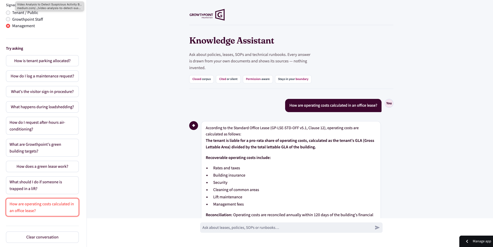
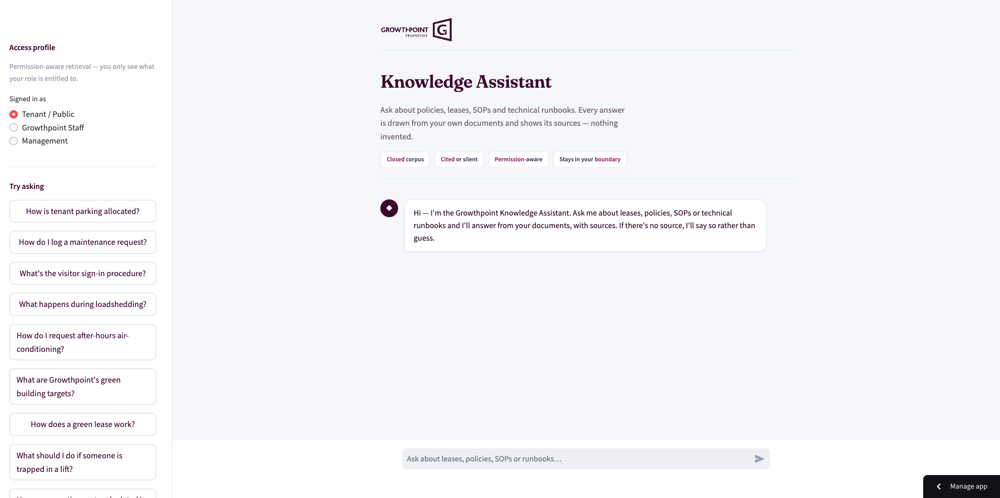
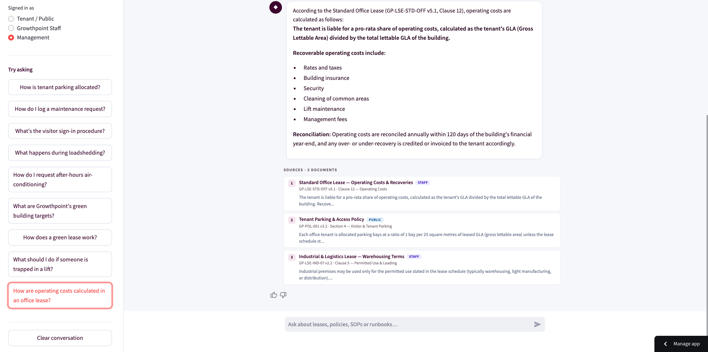
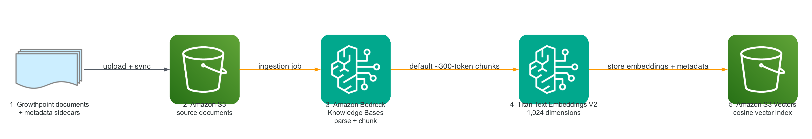
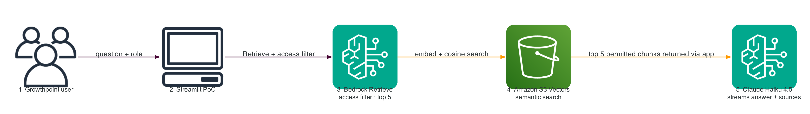
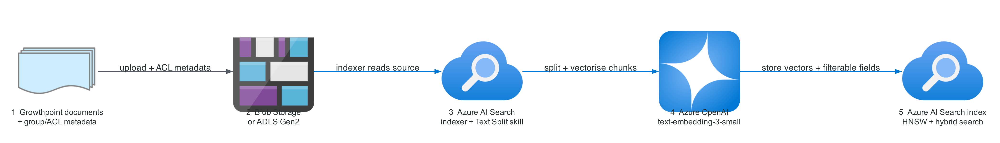
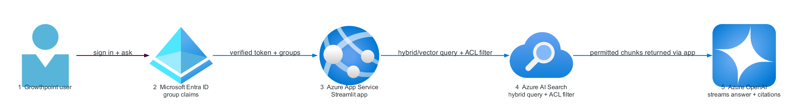

# Growthpoint Knowledge Assistant

**A practical guide to the AWS RAG proof of concept, with an equivalent Azure design**

**Status:** Proof of concept demo using fictional data
**Version:** 1.0 · October 2026

**Open the demo:** [launch the Growthpoint Knowledge Assistant](https://teams.public.onecdn.static.microsoft/evergreen-assets/safelinks/2/atp-safelinks.html)

---

## 1. What we built

We built a small chat assistant that answers questions from a controlled set of Growthpoint-style documents. The demo is meant to make the RAG pattern tangible: ask about parking, maintenance, leases, emergency procedures or technical runbooks, get a short answer, and see the source passages that supported it.

The current corpus contains **25 fictional documents** created only for the PoC: 9 policies, 5 lease documents, 6 standard operating procedures and 5 technical runbooks. They are deliberately short and cover public, staff and management access levels. They do not contain real Growthpoint information and should not be treated as policy.

The demo shows four useful behaviours:

| Behaviour | What the user sees |
|---|---|
| Answers from a closed document set | The assistant works from ingested documents, not an internet search. |
| Permission-aware retrieval | A selected access profile changes which documents can be retrieved. |
| Cited answers | Successful answers include compact, numbered source cards with title, reference, section and an extract. |
| Cited or silent | If the available context does not answer the question, the assistant says so instead of improvising. |

The web interface is a Streamlit app. For easy customer testing, the PoC can run on Streamlit Community Cloud while the retrieval and model services run on AWS. That split is convenient for fictional data, but it is not the target design for real documents. Before genuine Growthpoint content is loaded, the app, credentials and data should move inside the agreed customer boundary.

This is a demonstration, not a finished employee service. In particular, the **role dropdown is simulated**. It proves that retrieval filters work, but it does not prove who the user is. Production access must come from an authenticated identity and verified group membership.

### What the demo looks like

A quick tour of the three things a tester sees. You can also [open the live demo](https://teams.public.onecdn.static.microsoft/evergreen-assets/safelinks/2/atp-safelinks.html) and try these for yourself.

*The opening screen. The sidebar carries the access-profile selector and sample questions; the main panel introduces the assistant and the four guardrails.*

*Asking a question. The answer streams in from the assistant, grounded in the retrieved documents rather than invented.*

*Every answer shows its sources. The numbered cards name the document, its reference and section, and an extract — with an access-level badge on each, so you can see permission-aware retrieval at work.*

## 2. RAG in plain English

RAG stands for **Retrieval-Augmented Generation**. The name sounds more complicated than the idea.

A general-purpose language model is good at reading and writing, but it does not automatically know a company’s latest leases, operating procedures or permissions. Asking it to answer from memory creates two problems: it may not know the private content, and it may still produce a confident answer. RAG changes the job. We first find the relevant passages in an approved document set, then give those passages to the model with the question and ask it to answer from that material only.

Think of it as an open-book response:

1. **Retrieve:** search the approved library for the passages most closely related to the question.
2. **Augment:** place those passages, their metadata and the question into the model’s context.
3. **Generate:** ask the model to write a clear answer grounded in that context.

Retrieval and generation stay separate. That matters because documents can be changed without retraining the model. It also gives us a place to enforce permissions before restricted text reaches the model.

RAG does not magically guarantee truth. Its quality depends on the source documents, how they are split, whether the right passage is retrieved, and whether the final prompt keeps the model grounded. The demo makes those steps visible through source cards and deliberate refusals.

## 3. What happens when we add documents

Document ingestion runs when files are first added or later changed. It prepares the corpus for fast retrieval; it does not happen again for every chat message.

### Parse and attach metadata

The provisioning code uploads each text document to **Amazon S3** together with a `.metadata.json` sidecar. Each sidecar contains `title`, `category`, `doc_ref`, `section` and `access_level`. The first four fields make citations useful. `access_level` is filterable and drives the PoC permission rule.

An Amazon Bedrock Knowledge Base reads the S3 source. Bedrock extracts text from supported files, associates the metadata and prepares chunks for embedding. The [Bedrock Knowledge Bases documentation](https://docs.aws.amazon.com/bedrock/latest/userguide/knowledge-base.html) describes this managed ingestion and retrieval layer.

### Split the text into useful chunks

Search works better on focused passages than on an entire long document. A chunk should contain enough context to make sense while being narrow enough to represent one topic clearly.

The PoC’s provisioning code does **not** set an explicit chunking configuration. Bedrock therefore applies its **DEFAULT** strategy: roughly 300 tokens per chunk, with sentence-aware splitting. A token is a small unit of text; 300 tokens is usually a few paragraphs, not 300 words. AWS documents the available strategies and default behaviour in [How content chunking works](https://docs.aws.amazon.com/bedrock/latest/userguide/kb-chunking.html).

Most mock files are short enough to become approximately one chunk. That is useful for a demo because each result maps cleanly to a single fictional policy or procedure. It is not a final recommendation for real leases and manuals. Long schedules, tables, clause numbering and cross-references may need fixed-size chunks with overlap, semantic chunking, hierarchical chunking, or pre-processing based on document structure. We should test those options with real representative documents before choosing.

### Turn meaning into embeddings

An **embedding** is a numerical representation of meaning. No equation is needed to understand the purpose. Imagine these two phrases:

- “How many parking bays do we receive?”
- “Parking is allocated per square metre of leased area.”

They share few exact words, but they discuss the same idea. An embedding model places semantically similar text near each other in a multi-dimensional search space. A question about a fire assembly point lands elsewhere. This lets semantic search find useful passages even when the wording differs.

The demo uses **Amazon Titan Text Embeddings V2**. It produces a **1,024-dimension `float32` vector** for each chunk. The question is later embedded with the same model and dimensions; vectors from different configurations are not directly comparable. AWS lists Titan V2’s supported dimensions and input characteristics in the [Titan embeddings guide](https://docs.aws.amazon.com/bedrock/latest/userguide/titan-embedding-models.html).

### Store and search the vectors

Bedrock writes the vectors and associated metadata to **Amazon S3 Vectors**. The index is configured for `float32`, 1,024 dimensions and **cosine** distance. Cosine comparison is a way to rank vectors by similarity of direction, which works well for matching meaning in text.

S3 Vectors gives this PoC a managed, low-operations semantic vector store. It is semantic-only: it does not combine keyword and vector matching. The [S3 Vectors and Bedrock Knowledge Bases guide](https://docs.aws.amazon.com/AmazonS3/latest/userguide/s3-vectors-bedrock-kb.html) covers the integration. Exact identifiers and building names are a reason to evaluate a hybrid search engine when real usage is known.

## 4. The AWS architecture

The AWS design has two flows. The first runs only when documents change; the second runs on every question. Splitting them keeps each picture simple.

*Figure 1 — AWS ingestion. Documents are prepared once, then reused for every later question.*

Ingestion, left to right:

1. **Growthpoint documents and metadata sidecars** are the input. In the demo all 25 files are fictional. Each sidecar gives a source its citation details and an access level.
2. **Amazon S3** stores the source objects. An ingestion job syncs additions and changes into the knowledge base.
3. **Amazon Bedrock Knowledge Bases** parses the text and applies DEFAULT sentence-aware chunking at roughly 300 tokens, because no custom strategy is configured.
4. **Titan Text Embeddings V2** turns each chunk into a 1,024-dimension `float32` embedding.
5. **Amazon S3 Vectors** stores the embeddings and filterable metadata in a cosine index, ready for semantic search.

*Figure 2 — AWS runtime. Every question is permission-filtered before any text reaches the model.*

Runtime, left to right:

1. A **Growthpoint user** asks a question and the selected access role travels with it.
2. The **Streamlit app** orchestrates the request. In this PoC it runs on Streamlit Community Cloud and signs its AWS calls with a scoped **AWS IAM** credential (shown as a note, not a step, because it only authenticates the calls).
3. **Bedrock Retrieve** applies the `access_level` metadata filter and asks for the top five permitted chunks.
4. **Amazon S3 Vectors** embeds the question and runs the cosine similarity search.
5. **Claude Haiku 4.5 on Amazon Bedrock** receives the retrieved context through `ConverseStream` and streams the grounded answer, with compact numbered sources, back through the app.

The app orchestrates both API calls; S3 Vectors does not call the model directly. For production the recommendation is simple: host the app inside AWS, swap the scoped key for an IAM role, and send telemetry to Amazon CloudWatch.

Service symbols follow the official [AWS Architecture Icons](https://aws.amazon.com/architecture/icons/) guidance.

## 5. What happens when someone asks a question

A question follows a short but important sequence.

**First, the app calculates allowed levels.** The demo has an ordered model: public users can retrieve `public`; staff can retrieve `public` and `staff`; management can retrieve all three. The app sends an `access_level IN [...]` metadata filter as part of the Bedrock Knowledge Base retrieval request. Filtering during retrieval is the important point: disallowed chunks are not returned and are not placed in the model context.

**Second, Bedrock retrieves up to five chunks.** The live client calls the Knowledge Base `Retrieve` API with `numberOfResults` set to **5**. Behind that API, the question is embedded and compared with the S3 Vectors cosine index. The [Retrieve API reference](https://docs.aws.amazon.com/bedrock/latest/APIReference/API_agent-runtime_Retrieve.html) describes the query, vector-search configuration and returned results.

**Third, the app applies the first cited-or-silent gate.** If retrieval returns no chunks, it returns a short decline and does **not** call the language model. That saves a generation call and makes “no source, no answer” structural rather than just an instruction.

**Fourth, the app assembles context.** Each retrieved item is formatted with a number, title, document reference, section and chunk text. The system instruction tells the model to use only this context, not outside knowledge, and to decline when the context does not contain the answer.

**Fifth, the answer streams.** The app calls Amazon Bedrock `ConverseStream` with Claude Haiku 4.5 using the inference profile ID `us.anthropic.claude-haiku-4-5-20251001-v1:0`. The code uses a low temperature of 0.1 and a maximum of 1,000 output tokens. Bedrock’s [ConverseStream API](https://docs.aws.amazon.com/bedrock/latest/APIReference/API_runtime_ConverseStream.html) returns incremental events, so the interface can show text forming rather than waiting for the whole response.

**Finally, the app decides whether to show sources.** A successful response shows at most three compact source cards even though retrieval asks for five chunks. If the model produces a refusal because the nearest chunks are not actually useful, the app marks the result unanswered and suppresses the source cards. Showing weakly related citations beside a refusal would create false confidence.

## 6. What the guardrails really mean

The demo uses “guardrail” in a practical sense: a combination of architecture, retrieval rules, prompting and presentation. It is not claiming that a single switch removes every risk.

| Guardrail | How the demo enforces it | PoC limitation |
|---|---|---|
| **Closed corpus** | Retrieval searches only the configured knowledge base. There is no web-search fallback. The model is told to answer only from supplied context. | A model can still misunderstand context, so answer quality must be evaluated. |
| **Permission aware** | `access_level` is attached to each source and filtered inside retrieval before context assembly. | The role dropdown is **simulated**, not authenticated identity. |
| **Cited or silent** | Empty retrieval skips the LLM. Model refusals suppress source cards. Successful answers show source details. | Vector search can return loosely related chunks; evaluation and relevance tuning remain necessary. |
| **Content boundary** | AWS stores and processes the knowledge base and model calls. AWS explains Bedrock data protection in its [security documentation](https://docs.aws.amazon.com/bedrock/latest/userguide/data-protection.html). | Community Cloud is outside AWS and holds a scoped demo key. Use only fictional content in this arrangement. |

The Community Cloud access key is a short-term PoC choice, limited to the required AWS calls and replaceable at any time. An ARN or Knowledge Base ID identifies a resource; it does not authenticate the application. AWS still needs signed requests from credentials or an IAM role. For production, [AWS IAM guidance](https://docs.aws.amazon.com/IAM/latest/UserGuide/best-practices.html) recommends temporary credentials and roles rather than long-lived user keys.

Real Growthpoint content should not be loaded into the current public-hosted arrangement. The production-shaped move is to run the app inside the customer-controlled cloud boundary, derive permissions from sign-in, use an IAM role, add audit logging, and review data retention and support requirements.

## 7. How we would build the same demo in Azure

The RAG pattern is identical on Azure; the services differ. As on AWS, there are two flows: ingestion when documents change, and the question-and-answer path.

*Figure 3 — Azure ingestion. Azure AI Search drives the indexer, chunking and vectorisation in one managed flow.*

Ingestion, left to right:

1. **Growthpoint documents with group/ACL metadata** are the input. Carrying permission metadata from the source is what later enables security trimming.
2. **Azure Blob Storage or ADLS Gen2** holds the source files. ADLS Gen2 is useful when source ACLs are part of the security design.
3. **Azure AI Search** runs an indexer and skillset; the **Text Split skill** creates chunks with configurable size and overlap. Microsoft describes this in [integrated vectorization](https://learn.microsoft.com/en-us/azure/search/vector-search-integrated-vectorization) and the [Text Split skill guide](https://learn.microsoft.com/en-us/azure/search/cognitive-search-skill-textsplit).
4. **Azure OpenAI** generates embeddings with `text-embedding-3-small` for a cost-conscious PoC (or `text-embedding-3-large` where testing justifies it). The output dimensions must match the index vector field; see the [embedding skill documentation](https://learn.microsoft.com/en-us/azure/search/cognitive-search-skill-azure-openai-embedding).
5. **Azure AI Search index** stores the vectors using HNSW with filterable fields, ready for hybrid search.

*Figure 4 — Azure runtime. Identity is real here: Entra group claims become the security filter.*

Runtime, left to right:

1. A **Growthpoint user** signs in and asks a question.
2. **Microsoft Entra ID** returns a verified token and the user’s group claims — the key difference from the PoC’s simulated role dropdown.
3. **Azure App Service** (or Container Apps) hosts the Streamlit application inside the Azure boundary.
4. **Azure AI Search** runs a hybrid vector-plus-keyword query with a security filter on group or ACL fields, so only permitted chunks are returned. **Hybrid search** is an advantage over the demo’s semantic-only path when users ask with exact lease references, site names or technical codes. See [hybrid search](https://learn.microsoft.com/en-us/azure/search/hybrid-search-overview), the [document-level access overview](https://learn.microsoft.com/en-us/azure/search/search-document-level-access-overview) and the [security filter pattern](https://learn.microsoft.com/en-us/azure/search/search-security-trimming-for-azure-search).
5. **Azure OpenAI** (for example GPT-4o mini) streams the grounded answer with citations from the permitted results only.

Supporting services sit around this flow rather than inside it: a **Managed Identity** lets the app reach Azure services without stored keys, **Azure Key Vault** holds any unavoidable secrets, and **Azure Monitor** with **Application Insights** collects metrics, traces and failures.

This is an equivalent design, not the deployed system. Azure AI Search carries an always-on service cost but offers richer hybrid retrieval and a natural path to group/ACL security trimming — differences to test against the real document set, not decide from a diagram.

Symbols follow the official [Azure Architecture Icons](https://learn.microsoft.com/en-us/azure/architecture/icons/) and [Microsoft Entra architecture icons](https://learn.microsoft.com/en-us/entra/architecture/architecture-icons) guidance.

## 8. AWS and Azure service mapping

| Need | AWS PoC | Azure equivalent |
|---|---|---|
| Source documents | Amazon S3 | Blob Storage / ADLS Gen2 |
| Managed ingestion | Bedrock Knowledge Base ingestion | Azure AI Search indexer + skillset |
| Chunking | Bedrock DEFAULT, ~300 tokens | Text Split skill with size/overlap settings |
| Embeddings | Titan Text Embeddings V2, 1,024-d | Azure OpenAI `text-embedding-3-small` or `-large` |
| Vector index | Amazon S3 Vectors, cosine | Azure AI Search, HNSW |
| Retrieval | Bedrock `Retrieve`, semantic-only | AI Search vector or hybrid query |
| Generation | Claude Haiku 4.5 on Bedrock | GPT-4o mini on Azure OpenAI |
| Streaming | Bedrock `ConverseStream` | Azure OpenAI streaming responses |
| Permission filter | `access_level` metadata | Filterable group/ACL fields |
| App host | Community Cloud for PoC; AWS hosting for production | App Service / Container Apps |
| Workload identity | Scoped key for PoC; IAM role for production | Managed Identity |
| Secrets and monitoring | IAM/Secrets Manager; CloudWatch | Key Vault; Monitor and Application Insights |

## 9. What changes when real Growthpoint documents arrive

The UI does not need to be rebuilt simply because the knowledge base changes. Once real content is approved and ingested, the app queries the updated index. The careful work is preparing and evaluating that content.

1. **Inventory the sources.** Identify formats, owners, update frequency, duplicates, scanned PDFs, tables and documents that should be excluded.
2. **Define permissions before ingestion.** Map each source to authenticated user groups or an agreed access model. A three-level label may be too simple for property, region, tenant or team-specific documents.
3. **Run a chunking test.** Take representative leases, policies, SOPs and manuals. Compare chunk sizes, overlap and structure-aware options. Check whether retrieved passages keep clause headings, table context and exceptions together.
4. **Create an evaluation set.** Business owners should provide realistic questions, expected source passages, permission-negative cases and questions the assistant must decline. Measure retrieval first, then answer quality.
5. **Ingest in a controlled environment.** Load approved files and metadata, run the sync, review failures and sample the indexed results. Keep source version and ownership traceable.
6. **No UI redeploy for normal content updates.** Once ingestion completes, the running application reads the refreshed knowledge base. A redeploy is needed only when code, configuration or the data contract changes.
7. **Choose production hosting and authentication.** Before real data, decide AWS or Azure placement, network access, single sign-on, workload identity, logging, retention, support and recovery.

The first real-data milestone should be a measured pilot with a limited audience, not a bulk upload of every available file.

## 10. PoC versus production

| Area | PoC demo today | Production direction |
|---|---|---|
| Data | 25 fictional documents | Approved, owned and versioned Growthpoint sources |
| User identity | Simulated role dropdown | SSO with verified group claims |
| Hosting | Streamlit Community Cloud | Customer-controlled AWS or Azure hosting |
| Credentials | Scoped IAM user key for fictional data | IAM role or Azure Managed Identity |
| Permissions | Three `access_level` values | Group/ACL model matching real information boundaries |
| Retrieval | Default chunking and top-five semantic search | Evaluated chunking, relevance thresholds and possibly hybrid search |
| Quality | Demo scenarios and manual review | Repeatable retrieval/answer evaluation with business owners |
| Monitoring | Basic application status | Audit events, traces, alarms, feedback and operational ownership |
| Safety | Closed-corpus prompt and cited-or-silent flow | Additional content controls, testing, incident process and governance |

The PoC has done its job if stakeholders can see the interaction, challenge the answers, understand the architecture, and agree on what needs testing with real content. It is not evidence that every document or permission case is ready for production.

## 11. Sources

The main technical references are linked inline above. These official pages are the short reference list used for the guide:

**AWS**

- [Amazon Bedrock Knowledge Bases](https://docs.aws.amazon.com/bedrock/latest/userguide/knowledge-base.html)
- [Knowledge Base chunking](https://docs.aws.amazon.com/bedrock/latest/userguide/kb-chunking.html)
- [Titan Text Embeddings V2](https://docs.aws.amazon.com/bedrock/latest/userguide/titan-embedding-models.html)
- [Amazon S3 Vectors with Bedrock Knowledge Bases](https://docs.aws.amazon.com/AmazonS3/latest/userguide/s3-vectors-bedrock-kb.html)
- [Retrieve API](https://docs.aws.amazon.com/bedrock/latest/APIReference/API_agent-runtime_Retrieve.html)
- [ConverseStream API](https://docs.aws.amazon.com/bedrock/latest/APIReference/API_runtime_ConverseStream.html)
- [AWS Architecture Icons](https://aws.amazon.com/architecture/icons/)

**Microsoft Azure**

- [Azure AI Search integrated vectorization](https://learn.microsoft.com/en-us/azure/search/vector-search-integrated-vectorization)
- [Text Split skill](https://learn.microsoft.com/en-us/azure/search/cognitive-search-skill-textsplit)
- [Azure OpenAI embedding skill](https://learn.microsoft.com/en-us/azure/search/cognitive-search-skill-azure-openai-embedding)
- [Azure AI Search hybrid search](https://learn.microsoft.com/en-us/azure/search/hybrid-search-overview)
- [Document-level access control](https://learn.microsoft.com/en-us/azure/search/search-document-level-access-overview)
- [Azure Architecture Icons](https://learn.microsoft.com/en-us/azure/architecture/icons/)

Vendor documentation has been paraphrased and summarised. Content was rephrased for compliance with licensing restrictions.
